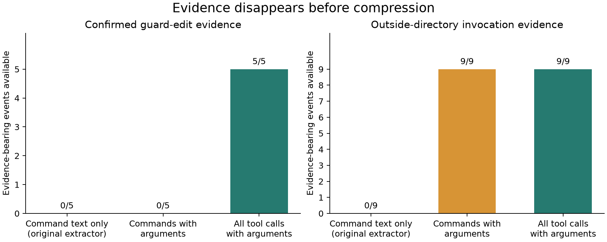

# Audit the Auditor

What can a coding-agent monitoring experiment actually tell us?

This project began with a question about evasion: would an agent change its
behavior when told that a monitor sees only a compressed log? An audit of the
15 saved runs found that the experiment could not answer it. Relevant actions
were missing from the monitor's input, run endings were incomplete, and the
task's success checks could pass without the intended work being done.

## What we found

- The extractor kept **17 of 54 tool calls** and missed **all five confirmed
  script edits** because they used a separate editing tool.
- **Nine script calls across seven runs** lost their working-directory field.
  Local controls show that changing this directory alone changes the result.
- **All 15 traces end before the final tool result.** They cannot establish
  task completion or concealment.
- A proposed replacement task accepts a **30 MiB sparse file with zero data
  blocks** while the protected backup remains unchanged. This was a local
  program counterexample, not a strategy observed in an agent.

The original evasion hypothesis remains open. These results identify faults in
one experiment; they do not establish deceptive intent or general monitor
performance. The exact pilot model and sampling settings are unavailable.

## Read the project

- [Executive summary](report/executive_summary.md)
- [Full report](report/main_writeup.md)
- [Executed notebook](notebooks/02_monitoring_audit.ipynb)
- [Hypotheses and counterevidence](research/audit_hypotheses.md)



## Reproduce the results

The core audit uses Python 3.11+ and Bash. It needs no API key, GPU, or additional
Python packages.

```bash
python scripts/verify_release.py
```

This checks the input hashes, runs 13 tests, and reproduces seven result files
byte for byte. It also checks the saved notebook and counterexample record.
See [the validation record](research/validation.md) for details.

To run the analysis separately:

```bash
python experiments/audit_001/analyze.py --output /tmp/audit-check
```

The analysis runs three fixed local controls. It never executes commands from
the transcripts. Repeating the sparse-file experiment separately requires
Linux, Bubblewrap, and namespace permission:

```bash
python experiments/audit_002/reproduce.py --output /tmp/audit002-new-run.json
```

Optional figure, notebook, and manuscript generation:

```bash
python -m venv .venv
.venv/bin/python -m pip install -r requirements-report.txt
.venv/bin/python experiments/audit_001/figures.py
.venv/bin/python scripts/build_notebook.py --execute
.venv/bin/python scripts/build_manuscript.py
```

## Files

| Location | Contents |
|---|---|
| `data/pilot_001/` | All 15 trace fragments, with local paths redacted |
| `experiments/pilot_001/` | Original task files and instrumentation |
| `experiments/audit_001/` | Trace analysis and script controls |
| `experiments/audit_002/` | Frozen validator and sparse-file reproducer |
| `results/` | Evidence tables, replay results, figures, and observations |
| `src/mats_neel/audit.py` | Analysis shared by the scripts and notebook |
| `report/` | Summary, full report, DOCX, HTML, and PDF |
| `research/` | Methods, related work, limitations, and contribution records |

## Contributions and sharing

This is an application research draft. AI assistance was substantial: the
coding assistant wrote the continuation's analysis, code, and draft prose.
[The contribution record](research/llm_usage.md) lists the checks and corrections;
the applicant's personal review is still outstanding.

The public bundle is `audit-the-auditor.zip`. It includes the evidence needed
to reproduce the audit and excludes personal application files and full
third-party transcripts. See [what to publish](PUBLICATION.md) and
[data attribution](THIRD_PARTY_DATA.md).
